# AutoSOC — Autonomous Cloud Security Operations Center

> **AI-Powered, Production-Minded AWS Security Operations Platform**  
> *DETECT → CORRELATE → TRIAGE → INVESTIGATE → APPROVE/RESPOND → RECORD → REPORT*

---

## Overview
**AutoSOC** is an autonomous cloud security operations platform designed specifically for Amazon Web Services (AWS) environments. It unifies security telemetry from AWS Security Hub, Amazon GuardDuty, AWS CloudTrail, and Amazon Inspector into a single high-density analyst workspace.

AutoSOC correlates cross-plane threats (e.g., matching ephemeral EC2 C2 beaconing with S3 bucket policy alterations and IAM credential anomalies), enriches them with Bedrock-assisted AI triage, enforces dry-run safety gates before any remediation, and maintains an immutable cryptographic audit trail.

---

## Architectural Flow (7-Stage Loop)

```mermaid
flowchart LR
    subgraph Ingestion["1. DETECT"]
        SH[AWS Security Hub]
        GD[Amazon GuardDuty]
        CT[AWS CloudTrail]
        IN[Amazon Inspector]
    end

    subgraph Correlation["2. CORRELATE & 3. TRIAGE"]
        CE[Cross-Plane Graph Engine]
        TR[Blast Radius Evaluator]
    end

    subgraph AI["4. INVESTIGATE"]
        BR[Amazon Bedrock Claude 3]
        DF[Deterministic Offline Fallback]
    end

    subgraph Response["5. APPROVE & RESPOND"]
        DR[Dry-Run Blast Simulation]
        HG[Human Authorization Gate]
        PB[Remediation Playbooks]
    end

    subgraph RecordReport["6. RECORD & 7. REPORT"]
        AU[Append-Only Audit Log]
        S3[Private S3 Bucket / SSE-KMS]
        CP[CIS / NIST / ISO Checklist]
    end

    Ingestion --> Correlation
    Correlation --> AI
    AI --> Response
    Response --> RecordReport
```



---

## Non-Negotiable Security Principles

1. **Zero Browser Secrets:** All AWS SDK calls occur exclusively server-side. No AWS access keys, secret keys, or STS tokens ever leak into browser bundles.
2. **Dry-Run Preview by Default:** Destructive actions (EC2 isolation, IAM key deactivation, S3 public block) always compute simulated blast radius before execution.
3. **Explicit Human Confirmation:** Automated AI suggests; authorized humans confirm. High-impact operations demand signed analyst acknowledgment.
4. **No Fabricated Success:** Live status lights illuminate only after real server-side STS verification succeeds. Synthetic demonstration data is clearly marked `DEMO DATA`.
5. **Prompt Injection & Secret Redaction Defense:** Telemetry is treated as untrusted strings. Passwords and credentials are automatically scrubbed before dispatch to Amazon Bedrock.
6. **Strict Least Privilege:** Telemetry ingestion roles are read-only and strictly isolated from remediation roles.

---

## Technical Stack
- **Framework:** Next.js 14 App Router + TypeScript (Strict Mode)
- **Styling:** Custom Swiss Brutalism + Cyber-Ops Theme (`#141613` Near-Black, `#F3F0E7` Warm Ivory, `#C7F36B` Acid Lime)
- **Validation:** Zod Schema Validation (`src/lib/env.ts`)
- **AWS SDK:** `@aws-sdk/*` v3 (STS, Security Hub, GuardDuty, CloudTrail, Config, Inspector, Bedrock, EC2, IAM, S3, WAFv2)
- **Testing:** Vitest + React Testing Library + JSDOM
- **Deployment & Packaging:** Docker, Docker Compose & Standalone Container on AWS EC2 (`deploy-ec2.sh`, `docker-compose.yml`)

---

## Quickstart & Local Development

### 1. Prerequisites
- Node.js >= 18.18 (v22+ recommended)
- npm >= 9.0
- (Optional) AWS CLI v2 configured with IAM Identity Center or CLI profile

### 2. Installation
```bash
# Clone the repository
git clone <repository-url>
cd AutoSOC

# Install dependencies
npm install
```

### 3. Environment Configuration
```bash
# Copy the environment template
cp .env.template .env.local
```
*Note: AutoSOC runs immediately in **Demo Mode** with realistic synthetic telemetry ($0.00 cost). You do not need AWS credentials to test the interface.*

### 4. Run Development Server
```bash
npm run dev
```
Open [http://localhost:3000](http://localhost:3000) in your browser.

---

## Operational Workspaces & Routes

| Route | Purpose | Safeguard / Mode |
| :--- | :--- | :--- |
| `/` | Editorial Swiss Brutalist Landing Page | Public |
| `/security` | Security Model, Principles & Threat Model | Public |
| `/docs` | AWS Setup Guide & IAM Reference | Public |
| `/login` | Analyst Session Authentication Console | Role-Gated |
| `/dashboard` | Command Center & Live Risk Overview | Authenticated |
| `/incidents` | Filterable Findings & Incident Manager | Authenticated |
| `/incidents/[id]` | Deep Investigation Workbench | Dry-run Gated |
| `/investigations` | Amazon Bedrock AI Assistant | Prompt Injection Shielded |
| `/response-playbooks`| Pre-approved Remediation Catalog | Human Approval Gated |
| `/forensics` | CloudTrail Timeline with SHA-256 Hashes | Chain-of-Custody Logged |
| `/iam-risk` | Overbroad Policy & Access Key Analyzer | Advisory Only |
| `/compliance` | CIS / NIST / ISO Checklist Mappings | Informative Mapping |
| `/integrations` | Server-Side Live AWS Status Verification | Real Health Checks |
| `/audit-log` | Append-Only Audit Trail (CSV/JSON Export) | Tamper-Evident |
| `/settings` | Demo Mode Toggle & Security Preferences | Configurable |

---

---

## AWS EC2 Production Deployment

AutoSOC is production-ready for deployment on **AWS EC2** (Amazon Linux 2023, Amazon Linux 2, or Ubuntu) using Docker & Docker Compose or as a standalone Next.js container.

### Option A: Automated One-Command EC2 Deployment (Recommended)

1. Launch an EC2 Instance (e.g., `t3.medium`, Amazon Linux 2023 or Ubuntu 22.04 LTS).
2. Attach an IAM Role with read-only security permissions (`SecurityAudit` or custom `AutoSOC-EC2-Role`).
3. SSH into the instance and run:

```bash
# Clone the repository
git clone https://github.com/Santa-24/AutoSOC.git
cd AutoSOC

# Run automated EC2 setup & deploy
chmod +x deploy-ec2.sh
./deploy-ec2.sh
```

The script automatically:
- Installs Docker, Docker Compose, Git, and curl
- Starts and enables the Docker service
- Adds the current user to the `docker` group
- Configures environment files (`.env`)
- Builds and starts the production container on port 80/3000
- Performs an automated health check against `/api/health`

### Option B: Manual Docker Compose Deployment

```bash
# Build and run in detached mode
docker compose up -d --build

# View logs
docker compose logs -f

# Verify service health
curl -f http://localhost/api/health
```

For complete instructions on EC2 instance sizing, Security Group rules (ports 80, 443, 3000, 22), IAM Instance Profile policies, automated User Data scripts, and Nginx reverse proxy with SSL (Let's Encrypt), refer to the comprehensive [EC2 Deployment Guide](EC2_DEPLOYMENT_GUIDE.md).

---

## Running Verification Tests & Type Checking

```bash
# Run unit and security tests with Vitest
npm test

# Run strict TypeScript type verification
npm run typecheck

# Run production build
npm run build
```

---

## Cost Transparency & Limitations
- **AutoSOC Software Cost:** Open source / Zero software fee.
- **Demo Mode:** $0.00 cloud cost (synthetic telemetry generated locally).
- **AWS Service Fees (When enabled in your AWS account):**
  - **AWS Security Hub:** 30-day free trial; ~$0.0010 per finding check after.
  - **Amazon GuardDuty:** 30-day free trial; billed on CloudTrail and VPC log volume.
  - **AWS CloudTrail:** First multi-region management event trail is free.
  - **Amazon Bedrock:** Pay-per-token (~$0.003/1k input, $0.015/1k output for Claude 3 Sonnet).
- **Compliance Disclaimer:** CIS, NIST, and ISO mappings represent informative technical checklists and do not constitute formal third-party regulatory audits or certifications.

---

## License
Apache 2.0 / MIT.
