<div align="center">

# 🛡️ AutoSOC

**Autonomous Cloud Security Operations Center for AWS**

*Detect → Correlate → Triage → Investigate → Approve/Respond → Record → Report*


[Overview](#-overview) · [Security Principles](#-security-principles) · [Quick Start](#-quick-start) · [Workspaces](#-workspaces) · [Deployment](#-aws-ec2-deployment) · [Testing](#-testing)

<!-- 📸 Add a screenshot or demo GIF: docs/assets/dashboard.png -->
<!--  -->

</div>

---

## 🎯 Overview

Security teams on AWS juggle findings spread across several consoles. **AutoSOC** pulls telemetry from **Security Hub, GuardDuty, CloudTrail and Inspector** into one analyst workspace. It correlates signals across services, then uses Amazon Bedrock to help triage them. Nothing destructive runs without a dry-run preview and a human approval.

An example it is built to catch: an EC2 instance beaconing to a C2 host, a suspicious S3 bucket policy change, and an IAM credential anomaly. Each looks minor alone, but together they show one incident.

> 💡 **Try it with no AWS account.** AutoSOC starts in **Demo Mode** with synthetic telemetry, clearly labeled `DEMO DATA`, at $0 cost.

---

## ✨ Key Features

| | Feature | Details |
|---|---|---|
| 🔗 | **Cross-plane correlation** | Links findings across Security Hub, GuardDuty, CloudTrail and Inspector into single incidents |
| 🤖 | **AI-assisted triage** | Amazon Bedrock (Claude) investigation assistant, with a deterministic offline fallback |
| 🧪 | **Dry-run blast radius** | Remediations such as EC2 isolation, IAM key deactivation and S3 public block are simulated before execution |
| ✅ | **Human approval gate** | High-impact actions require a signed analyst acknowledgment |
| 🔍 | **Forensics timeline** | CloudTrail events with SHA-256 hashes and chain-of-custody logging |
| 📜 | **Append-only audit log** | Tamper-evident trail, exportable as CSV or JSON |
| 📋 | **Compliance mapping** | CIS / NIST / ISO checklists *(informational, not a formal audit)* |
| 🔑 | **IAM risk analyzer** | Flags overbroad policies and risky access keys |

---

## 🏗️ Architecture: the 7-stage loop

```mermaid
flowchart LR
    subgraph D["1 · DETECT"]
        SH[Security Hub]
        GD[GuardDuty]
        CT[CloudTrail]
        IN[Inspector]
    end
    subgraph C["2 · CORRELATE  3 · TRIAGE"]
        CE[Cross-plane graph engine]
        TR[Blast-radius evaluator]
    end
    subgraph A["4 · INVESTIGATE"]
        BR[Amazon Bedrock]
        DF[Offline fallback]
    end
    subgraph R["5 · APPROVE & RESPOND"]
        DR[Dry-run simulation]
        HG[Human approval gate]
        PB[Remediation playbooks]
    end
    subgraph RR["6 · RECORD  7 · REPORT"]
        AU[Append-only audit log]
        S3[(Private S3 · SSE-KMS)]
        CP[CIS / NIST / ISO checklist]
    end
    D --> C --> A --> R --> RR
```



---

## 🔐 Security Principles

1. **Zero browser secrets.** All AWS SDK calls run server-side. No access keys, secret keys or STS tokens reach the browser bundle.
2. **Dry-run by default.** Destructive actions compute a simulated blast radius before anything executes.
3. **Humans confirm.** The AI suggests, and an authorized analyst approves.
4. **No fabricated success.** Live status indicators turn on only after real server-side STS verification. Synthetic data is always labeled.
5. **Untrusted telemetry.** Logs are treated as untrusted input to resist prompt injection, and credentials are redacted before anything is sent to Bedrock.
6. **Least privilege.** Read-only ingestion roles are kept separate from remediation roles.

See [`SECURITY.md`](SECURITY.md) for the vulnerability disclosure policy.

---

## 🧰 Tech Stack

| Area | Technology |
|---|---|
| **Framework** | Next.js 14 (App Router), TypeScript (strict) |
| **Styling** | Tailwind CSS, custom Swiss-brutalist cyber-ops theme |
| **Validation** | Zod (`src/lib/env.ts`) |
| **AWS SDK v3** | STS, Security Hub, GuardDuty, CloudTrail, Config, Inspector, Bedrock, EC2, IAM, S3, WAFv2 |
| **Testing** | Vitest, React Testing Library, JSDOM |
| **Delivery** | Docker, Docker Compose, GitHub Actions, AWS EC2 |

---

## 🚀 Quick Start

### Prerequisites

- Node.js **18.18+** (22+ recommended) and npm **9+**
- *(Optional)* AWS CLI v2 with a configured profile, only for live mode

### Run locally

```bash
git clone https://github.com/Santa-24/AutoSOC.git
cd AutoSOC
npm install
cp .env.example .env.local     # Demo Mode works with defaults
npm run dev
```

Open <http://localhost:3000>.

### Switching to live AWS data

Fill in the AWS values in `.env.local` and restart. Use an identity with **read-only** permissions (for example, the managed `SecurityAudit` policy). The Integrations page reports real connection health from server-side STS checks.

---

## 🗺️ Workspaces

| Route | Purpose | Safeguard |
|---|---|---|
| `/` | Landing page | Public |
| `/security` | Security model and threat model | Public |
| `/docs` | AWS setup and IAM reference | Public |
| `/login` | Analyst sign-in | Role-gated |
| `/dashboard` | Command center and live risk overview | Authenticated |
| `/incidents` | Filterable findings and incident manager | Authenticated |
| `/incidents/[id]` | Deep investigation workbench | Dry-run gated |
| `/investigations` | Bedrock AI assistant | Prompt-injection shielded |
| `/response-playbooks` | Pre-approved remediation catalog | Human approval |
| `/forensics` | CloudTrail timeline with SHA-256 hashes | Chain-of-custody logged |
| `/iam-risk` | Overbroad policy and access key analyzer | Advisory only |
| `/compliance` | CIS / NIST / ISO mappings | Informational |
| `/integrations` | Live AWS connection status | Real health checks |
| `/audit-log` | Append-only trail (CSV / JSON export) | Tamper-evident |
| `/settings` | Demo-mode toggle and preferences | Configurable |

---

## ☁️ AWS EC2 Deployment

Works on Amazon Linux 2023, Amazon Linux 2 or Ubuntu 22.04+.

**Option A: one-command deploy**

1. Launch an EC2 instance (for example `t3.medium`) with an IAM role carrying read-only security permissions.
2. SSH in and run:

```bash
git clone https://github.com/Santa-24/AutoSOC.git
cd AutoSOC
chmod +x deploy-ec2.sh
./deploy-ec2.sh
```

The script installs Docker, Compose, Git and curl, configures `.env`, builds and starts the container, and health-checks `/api/health`.

**Option B: Docker Compose**

```bash
docker compose up -d --build
docker compose logs -f
curl -f http://localhost/api/health
```

For instance sizing, Security Group rules, IAM instance profile policies, and an Nginx reverse proxy with Let's Encrypt SSL, see the [EC2 Deployment Guide](EC2_DEPLOYMENT_GUIDE.md).

---

## 🧪 Testing

```bash
npm test            # Vitest unit and security tests
npm run typecheck   # strict TypeScript check
npm run build       # production build
```

---

## 💰 Cost & Limitations

- **AutoSOC itself:** free and open source. **Demo Mode:** $0 cloud cost.
- **Live mode:** you pay AWS for the services you enable (Security Hub, GuardDuty, CloudTrail beyond the free trail, Bedrock per token). Check current rates on the AWS pricing pages before enabling them.
- **Compliance mappings** are informational checklists. They are not a formal audit or certification.
- Automated remediation is intentionally gated. AutoSOC assists analysts and does not replace them.

---

## 🗺️ Roadmap

- [ ] Persistent database for incidents and audit log
- [ ] More remediation playbooks (WAF rules, security group quarantine)
- [ ] Multi-account / AWS Organizations support
- [ ] Screenshots and a recorded demo

*(Edit to match your real plans.)*

---

## 📄 License

Released under the **Apache License 2.0**. See [`LICENSE`](LICENSE).

<div align="center">

If AutoSOC is useful to you, consider giving it a ⭐

</div>
